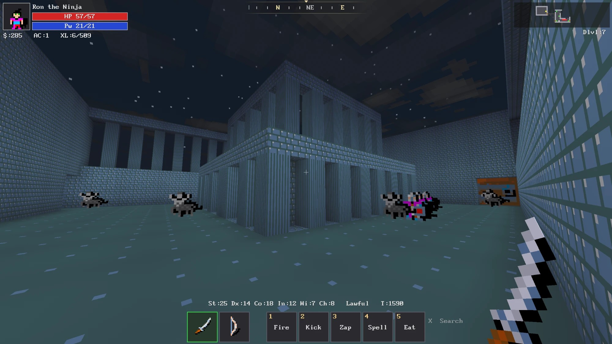
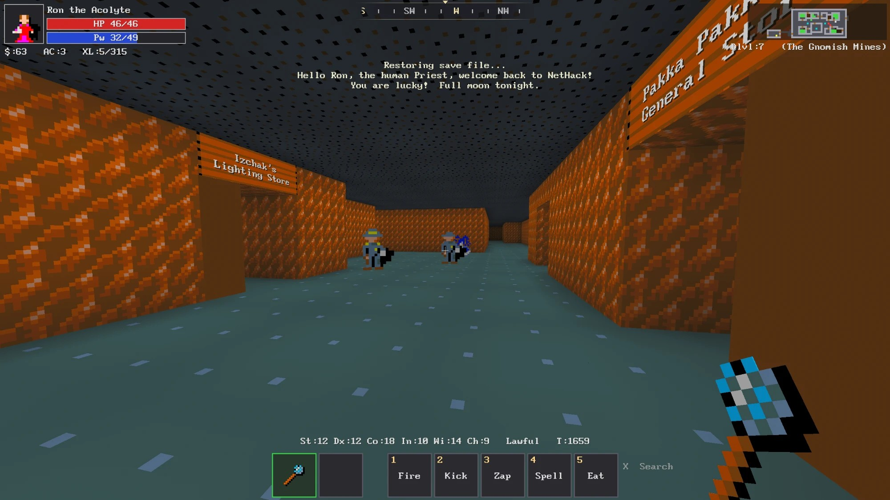

# VoxHack

**NetHack 3.7 in first person, in a voxel world.** Based on NetHack, running on a
modified [Luanti](https://www.luanti.org/) engine. Windows only.



**Website:** https://mreveryday98.github.io/VoxHack/ · **itch.io:** https://mreveryday.itch.io/voxhack · **Download:** [latest release](../../releases/latest) · **Changes:** [CHANGELOG](CHANGELOG.md)

NetHack still decides everything: every rule, every die roll, every monster.
VoxHack is how you see it and move through it: walk the dungeon freely, look
around in 3D, swing at what's in front of you, and watch the Mazes of Menace
take shape around you.

- **NetHackWiki built in:** point at any monster, item or feature and press **F2** to read its NetHackWiki page right in the game
- Free movement in a 3D dungeon built from NetHack's own levels
- Real-time-ish play: time crawls while you stand still and runs as you move
- Monsters as sprites from NetHack's tile set, walking, fighting and fleeing in 3D
- Mouse-driven actions: attack, fire, a right-click action wheel, an item hotbar
- NetHack's special levels hand-built as 3D areas (Sokoban, the Oracle, the Planes...)
- Sound effects, music and skies for each part of the dungeon



## Play

Download the latest zip from [itch.io](https://mreveryday.itch.io/voxhack) or [Releases](../../releases), unpack it anywhere and
run **Create Play Shortcut.bat** (or `Launchers\Play VoxHack.bat`). Your game,
settings and high scores stay inside that folder.

| Input | Action |
|---|---|
| WASD + mouse | Move and look |
| Space | Wait a turn; **hold to jump** (Knights, jumping boots): look at a green square and let go. In a pit: climb out |
| Left click | Attack what's in reach under your crosshair (hold to keep attacking) |
| Shift + left click | Fire your quivered ammo where you look |
| Right click | Tap: the obvious action for what you point at (open a door, take the stairs, talk). Hold: an action wheel |
| Shift + right click (hold) | Actions on yourself (pray, rest, sit, engrave, loot, look here...) |
| Alt + right click (hold) | Use an item (quaff, read, apply, wear, put on, wield...) |
| Ctrl + right click (hold) | Magic and abilities (turn undead, monster abilities, invoke, skills, spells) |
| E | Your wielded weapon's action (hold for its wheel) |
| Middle click | Look at what's under the crosshair |
| 1-5 | Fire, Kick, Zap, Spell, Eat |
| F | Pick up (or tap right click while standing on items) |
| Q | Invoke what you wield (an artifact's power, a crystal ball) |
| X | Search (hold to keep searching) |
| Ctrl + X | Search for a number of turns (X stops it) |
| P | Pay the shopkeeper |
| G | Advance a skill (when you can) |
| I | Inventory and equipment |
| Z | The big overhead map |
| T | NetHack's command line (`#pray`, `20s`...) |
| M | Mute or unmute the sound |
| Esc | The game menu (Help lists every key); closes any window |
| F1 | Hide or show the HUD |
| F2 | Look up what you're pointing at on NetHackWiki (F2 again closes it) |
| F3 | Find any command by name or what it does, and do it |
| F4 | ASCII mode: the world drawn in NetHack's characters |
| F11 / F12 | Fullscreen / screenshot |

Look steeply down or up when zapping, digging or casting to aim down (`>`) or up (`<`).

## Build from source

You need Windows with [MSYS2](https://www.msys2.org/) (in `C:\msys64`) and Python 3
with Pillow.

1. In an MSYS2 shell, install the CLANG64 toolchain and libraries:

   ```sh
   pacman -S --needed git mingw-w64-clang-x86_64-{clang,cmake,ninja,SDL2,freetype,openal,libvorbis,curl,sqlite3,zstd,luajit,jsoncpp,gettext,gmp,libjpeg-turbo,libpng}
   ```

2. Clone with the two modified engines (NetHack and Luanti, branch `nhv`):

   ```sh
   git clone --recurse-submodules https://github.com/MrEveryDay98/VoxHack.git
   ```

3. Build and assemble the game (from the repository, in Git Bash or MSYS2):

   ```sh
   tools/clang64.sh 'sh tools/deploy.sh'
   ```

4. Play: `Launchers\Play VoxHack.bat`. To make a release zip:
   `python -I tools/make_release.py` (writes `dist/VoxHack-<date>-<commit>.zip`).

Lua changes in `game/nethackvoxel` need no rebuild: the game folder is linked
into the engine. More detail in [docs/STATUS.md](docs/STATUS.md).

### Layout

| Path | What |
|---|---|
| `game/nethackvoxel` | The game (Luanti mods, in Lua): the 3D world, controls, HUD, sound |
| `nhcore` | The bridge between NetHack and the engine (built into `nethack.dll`) |
| `external/nethack` | NetHack 3.7, modified (submodule, branch `nhv`) |
| `external/luanti` | Luanti, modified (submodule, branch `nhv`) |
| `tools` | Build, release and asset tools, and the sound/sky/block editor |

## Credits and licence

VoxHack is based on NetHack, by the NetHack DevTeam, and is not an official
NetHack release. It is distributed under the NetHack General Public License
(see [LICENSE](LICENSE)). Luanti is under the LGPL 2.1 or later. What every
part of the game is and where it comes from is in [CREDITS.md](CREDITS.md).
